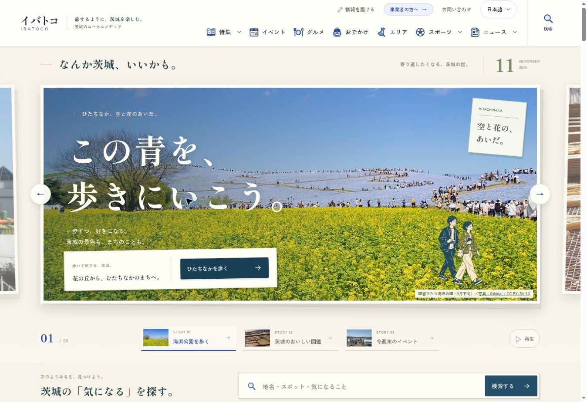
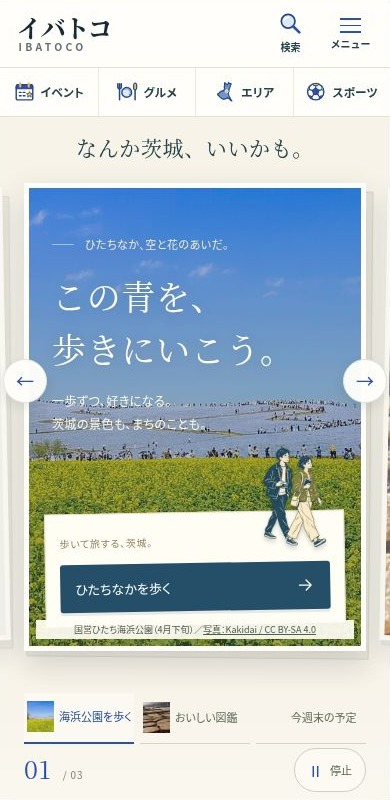

# v42 提出版との差分修正（トップ・共通ヘッダー）

基点：main `cc665284545fbda44be9ab92f19c228e912c2280`（#512 公開済み）。提出された `ibatoco-all-pages-design-v42.zip` の index.html・fv.css・home41.css・ヘッダー・検索の指定を参照。確認日：2026年11月7日（日本時間）。

## この修正で揃えた箇所

| 箇所 | 修正 |
| --- | --- |
| 共通ヘッダー | 提出版の色付きSVGを共通の V42Icon にまとめ、PCの7カテゴリ・スマホの4カテゴリへ追加。PCの2段の高さ・左右余白、スマホの検索とメニューの縦積みも調整。リンクとメニューの開閉処理は維持。 |
| ネモフィラのFV | 白い案内カード、右上の札、青緑のCTA、写真の切り取り位置と重ねる色、二人の挿絵の位置を提出版へ合わせた。スマホの見出しは34px、350px以下は29pxで指定の2行を維持。 |
| 特集の切替 | 写真付きの3タブ。写真は既存のFV画像を再利用し、重複する装飾なので alt=""。320pxでは文字を優先する提出版の指定を維持。 |
| 検索と読み順 | PCは見出し左・検索右の帯、スマホは縦並び。検索の後に「今月の、よりみち帖。」とイベントを置いた。人気記事・開催中・テーマ6件も残し、後ろへ移動。 |

検索の補助リンクは確認済みの既存URLだけを使う（日付 /events/、エリア /area/、目的 /odekake/、条件 /discover/）。提出見本の「半日の旅」「ペットと」を、対応ページを作らずに機能するように見せることはしていない。

## 確認画像

PC（実ブラウザの画面。ブラウザ幅は約1360px）：

スマホ390px（プレビュー内の390pxフレーム。外側の確認画面を切り取ったもの）：

## 検証

- `npm ci` 成功。
- `npm run check` 成功。astro check は 0 errors / 0 warnings。
- 手元の `npm run verify` は終了コード0。単体テスト98件成功、失敗0。既存記事由来の鮮度警告18件あり。
- ローカルのUIスモーク・Visual RegressionはChrome本体がないため未実施。上記verifyの成功と、これらの実行成功は区別する。
- 実ブラウザの表示幅320・360・390・430・768・1024・1280・1440pxで、横スクロール0。スマホの検索入力は16px。PCのカテゴリ7アイコンとロゴが重ならないことを確認。
- 390pxでFV3枚の切替とリンク、タブの選択状態、メニュー開閉とEscで閉じる動作を確認。検索「笠間」は /search/?q=笠間 に遷移し30件表示。
- 幅別の確認値は `v42-fidelity-checks.json`。
- 変更前後818ページを比較し、title・description・canonical/alternate・robots・OG・H1・JSON-LD・外部リンク（rel含む）・フォームの差分0。既存の内部リンク先の削除0。
- sitemap.xml・news-sitemap.xml・robots.txt・rss.xml・llms.txt・_headers・_redirects は変更前とバイト一致。
- 意図した差分はTOPの /discover/ へのリンク追加1先と、モジュールの配置変更。既存の data-module は全て維持し、移動した開催中・人気欄に home_popular を追加。GA4イベント名や許可リスト・設定は変更していない。

## 公開前に残ること

- PRの必須CIを確認する。main側の記録によってTOPは12月5日まで観測中。通常のUI修正は `scripts/observation-guard.mjs` が止める条件に当たり、事実・計測の修正として例外を偽装しない。ガードの無効化・期限の変更・workflow変更はしていない。
- 公開日が確定したら、内部リンクと構成変更のSEO記録を実公開日に合わせて追記する。
- 本番はこの修正案に更新していない。マージ・デプロイ後のSHAと実画面の確認は別途必要。
- #515（残りのページ種別）・#516（モデルコース導線）はこの修正に混ぜていない。v42全42種の完成・全ページの見た目の一致を、この修正の完了扱いにしない。
